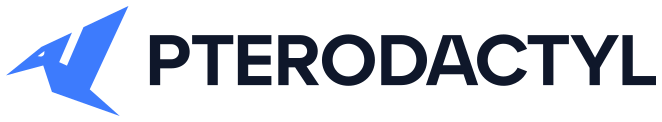
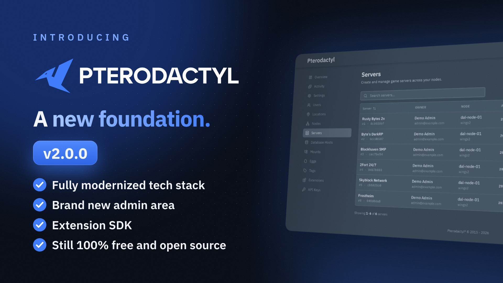

<div align="center">

# ⚡ N1LUX PETRO PANEL (N1X PANEL)
### Multi-Language Docker-Free Cloud Hosting Control Panel

[](https://github.com/CyberN1LUX/N1X-PANEL)
[](https://opensource.org/licenses/MIT)

</div>

## 🚀 One-Line Automated Installer (Debian / Ubuntu)

Run this single command on your Debian / Ubuntu server (as **root**) to open the non-stop installer menu:

```bash
bash <(curl -fsSL https://raw.githubusercontent.com/CyberN1LUX/N1X-PANEL/main/install.sh)
```

> Not logged in as root? Run `sudo -i` first, then execute the command above.

### 🎛️ Installer Menu

| Option | Action |
| :---: | :--- |
| **1** | **Clone / Update Code** — clone the repository or pull the latest `main` branch. |
| **2** | **Install Everything & Setup** — install all dependencies, build the panel, configure the database, runner, admin account and systemd services. |
| **3** | **Port Management** — change the panel port, restart services, view status and open the firewall port. |

The installer supports Debian and Ubuntu and sets up:

- **PHP 8.2 / 8.3** with all required extensions and **Composer**
- **Node.js 22 LTS + Yarn** with a production frontend build
- **Python 3 + venv/pip** for Python application hosting
- **MariaDB** database, **Redis** queue backend and **Nginx** reverse proxy
- `.env` generation, migrations, seeders and the native `n1x-runner` node
- `n1x-panel`, `n1x-runner` and `n1x-queue` systemd services (auto-start on boot)

**Default install directory:** `/opt/n1x-panel`  
**Default panel port:** `8000` — choose another port during setup or later from menu option **3**.

After installation the panel is available at `http://YOUR_SERVER_IP:<PORT>`, and the installer prints the administrator credentials plus the service management commands.

---

<p align="center">
  <a href="https://pterodactyl.io">
    <picture>
      <source media="(prefers-color-scheme: dark)" srcset=".github/assets/logo-dark.svg">
      
    </picture>
  </a>
</p>


# Pterodactyl Panel

Pterodactyl® is a free, open-source game server management panel built with PHP, React, and Go. Designed with security
in mind, Pterodactyl runs all game servers in isolated Docker containers while exposing a beautiful and intuitive
UI to end users.

Stop settling for less. Make game servers a first class citizen on your platform.

## Pterodactyl v2 Beta is Out!

Pterodactyl v2.0.0-beta.1 is now available! The next major version introduces a modernized tech stack, a redesigned admin area, and an extension SDK built into the panel. It remains 100% free and open source under the MIT license.

[](https://www.youtube.com/watch?v=1ER4kv0jVEU)

- [Get started with v2](https://docs.pterodactyl.io/v2/panel/getting-started)
- [Upgrade from v1](https://docs.pterodactyl.io/v2/upgrading/upgrading-from-v1)
- [Release notes](https://github.com/pterodactyl/panel/releases/tag/v2.0.0-beta.1)

Development happens on the [`2.0-develop`](https://github.com/pterodactyl/panel/tree/2.0-develop) branch. The v2 branch is currently in beta, while `1.0-develop` remains the current stable release line.


## Documentation

* [Panel Documentation](https://pterodactyl.io/panel/1.0/getting_started.html)
* [Wings Documentation](https://pterodactyl.io/wings/1.0/installing.html)
* [Community Guides](https://pterodactyl.io/community/about.html)
* Or, get additional help [via Discord](https://discord.gg/pterodactyl)

## Sponsors

I would like to extend my sincere thanks to the following sponsors for helping fund Pterodactyl's development.
[Interested in becoming a sponsor?](https://github.com/sponsors/pterodactyl)

| Company                                                                           | About                                                                                                                                                                                                                                           |
|-----------------------------------------------------------------------------------|-------------------------------------------------------------------------------------------------------------------------------------------------------------------------------------------------------------------------------------------------|
| [**Buildurly**](https://buildurly.com/)                                           | Buildurly is a hardware procurement company. They deliver tailored, enterprise-grade hardware solutions designed around your unique needs. From sourcing to delivery, Buildurly's white-glove service ensures a seamless, worry-free, professional experience.                                                                                                                                          |
| [**Hosturly**](https://hosturly.com/)                                             | Hosturly is an enterprise hosting provider. They provide cost-effective, high-performance, and reliable services, including VPS, Web, Dedicated, and Colocation.                                                                                |
| [**indifferent broccoli**](https://indifferentbroccoli.com/)                      | indifferent broccoli is a game server hosting and rental company. With them, you get top-notch computer power for your gaming sessions. They destroy lag, latency, and complexity--letting you focus on the fun stuff.                         |
| [**Infraly, LLC**](https://infraly.co/)                                           | Infraly is an infrastructure company powering the next generation of online services. Through their brands, Infraly delivers cutting-edge solutions across multiple markets. Their vertically integrated approach provides unmatched performance, scalability, and reliability, giving our customers full control.                                                                                     |
| [**MineStrator**](https://minestrator.com/)                                       | MineStrator is a game server hosting provider. Looking for the most high-end French hosting company for your Minecraft server? More than 24,000 members on our Discord trust us. Give us a try!                                                |
| [**Physgun**](https://physgun.com/)                                               | Physgun is a game server hosting provider. Most providers rent rack space and rebrand a panel. At Physgun, they engineer the performance, write the features, and staff the support. Physgun truly is game hosting perfected!                   |
| [**WISP**](https://wisp.gg/)                                                      | WISP is an industry-leading SaaS platform for game server management, designed for hosting companies, gaming organizations, and enthusiasts. WISP combines modern, intuitive interfaces with powerful tools, making server deployment and administration seamless, scalable, and efficient.                                                                                                                 |


### Supported Games

Pterodactyl supports a wide variety of games by utilizing Docker containers to isolate each instance. This gives
you the power to run game servers without bloating machines with a host of additional dependencies.

Some of our core supported games include:

* Minecraft — including Paper, Sponge, Bungeecord, Waterfall, and more
* Rust
* Terraria
* Teamspeak
* Mumble
* Team Fortress 2
* Counter Strike: Global Offensive
* Garry's Mod
* ARK: Survival Evolved

In addition to our standard nest of supported games, our community is constantly pushing the limits of this software
and there are plenty more games available provided by the community. Some of these games include:

* Factorio
* San Andreas: MP
* Pocketmine MP
* Squad
* Xonotic
* Starmade
* Discord ATLBot, and most other Node.js/Python discord bots
* [and many more...](https://eggs.pterodactyl.io)

## License

Pterodactyl® Copyright © 2015 - 2022 Dane Everitt and contributors.

Code released under the [MIT License](./LICENSE.md).
